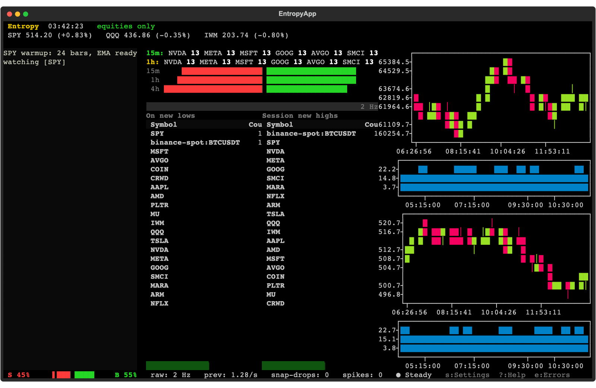
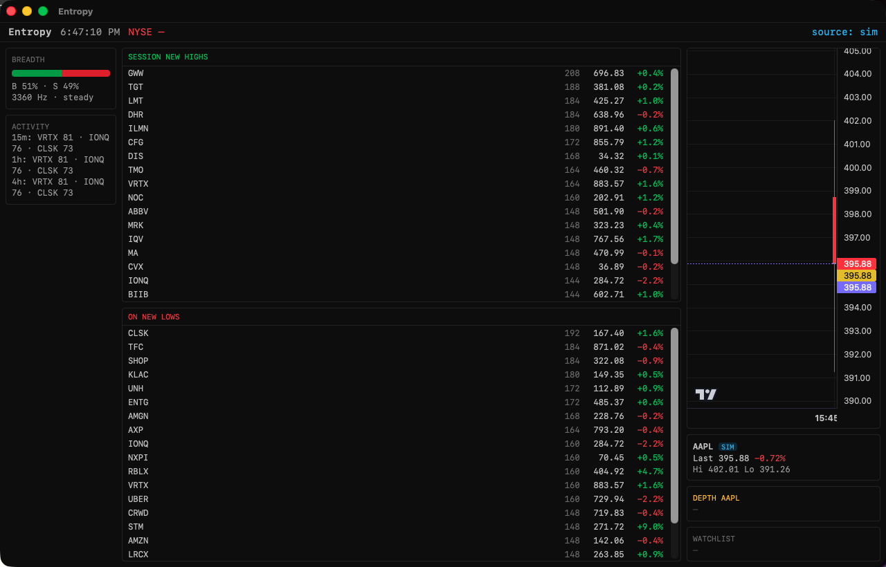

# Entropy

A market-breadth scanner for crypto and US equities, with a terminal dashboard, a native macOS cockpit, and paper-trading research tools. Entropy tracks new highs, new lows, momentum changes, and buying/selling breadth across symbols, alongside a focus chart, watchlist, quote panel, and depth ladder.

| Terminal dashboard | Native macOS cockpit |
| :---: | :---: |
| [](docs/assets/entropy.png) | [](docs/assets/entropy-native.png) |

## What it does

- Scans rolling windows for new highs/lows, spikes, drops, and momentum changes.
- Offers scanner timeframes of `1m`, `5m`, `15m`, `1h`, and `4h`, with three rolling windows per profile and a separate session high/low.
- Displays focus-symbol candles, EMA overlays, volume, quotes, watchlists, and an optional depth panel.
- Keeps scanner timeframe, chart candle interval, and bot computation cadence independent.
- Saves settings and watchlists locally, with the terminal and native frontends sharing `~/.entropy/settings.json`.
- Runs paper strategies with risk limits, configurable costs, calibration, and trade reports.

## Run the terminal app

Requires Python 3.12+, Git, and [uv](https://docs.astral.sh/uv/). Dependency setup fetches the pinned Crocodile feed engine from GitHub.

```bash
git clone https://github.com/nazmiefearmutcu/Entropy.git
cd Entropy
uv sync
uv run entropy ui
```

Choose the equity feed explicitly when needed:

```bash
uv run entropy ui --equity-source sim
uv run entropy ui --equity-source live
uv run entropy ui --equity-source auto
```

`sim` selects seeded equity simulation. `auto` selects live equities while the US market is open and simulation otherwise. The crypto feed is configured separately.

| Control | Action |
|---|---|
| `/` | Search symbols |
| `w` | Add/remove the focused symbol from the watchlist |
| `:` | Open the command bar, for example `chart AAPL`, `tf 15m`, or `depth NVDA` |
| `s` | Open settings |
| `?` / `h` | Show help |
| `e` / `q` | Show errors / quit |

## Native macOS app

The native cockpit uses the same Python engine through a Tauri shell and React frontend. Build instructions, sidecar setup, and frontend development commands are in [`native/README.md`](native/README.md).

An older Apple Silicon installer is available under [release v0.1.0](https://github.com/nazmiefearmutcu/Entropy/releases/tag/v0.1.0). The newer v0.2.0 release has no attached installer; build from source for the current code. The macOS build is unsigned.

## Data sources and fidelity

Crypto feeds use [Crocodile](https://github.com/nazmiefearmutcu/Crocodile), with Coinbase/Binance defaults and connector support for additional venues. Availability depends on the selected venue and channels.

For live US equities, the adapter selects the first configured provider below:

| Provider | Configuration | What the scanner receives |
|---|---|---|
| Alpaca | `ALPACA_API_KEY` and `ALPACA_API_SECRET` | IEX trade stream; adapter caps the subscription at 30 symbols |
| Finnhub | `FINNHUB_API_KEY` | Trade stream; adapter caps the subscription at 50 symbols |
| Google Finance | No key; fallback when the above are absent | Polled last-price quotes re-emitted into the tick pipeline |

Equity buying/selling direction is inferred with a tick rule. Keyless quotes are suitable for coarse scanning, but are not an exchange trade tape.

The keyless equity depth panel derives a volume-at-price ladder from Yahoo one-minute bars and labels it **SYNTH**. It represents historical volume concentration, not resting orders. With Alpaca credentials, the same panel can display **L1** top-of-book data. Neither path supplies full-depth equity L2. Equity charts warm from historical bars where supported; sub-minute candles accumulate from the incoming feed.

## Architecture

```text
Crocodile connectors / equity simulator
                  |
          normalized event queues
                  |
          Python scanner engine
             /             \
    Textual dashboard   FastAPI sidecar
                               |
                      local WebSocket + REST
                               |
                       React / Tauri cockpit
```

- [`src/entropy/engine/`](src/entropy/engine/): rolling extrema, momentum, breadth, candle aggregation, and snapshots.
- [`src/entropy/feeds/`](src/entropy/feeds/): crypto connectors, equity provider adapters, simulation, and warmup.
- [`src/entropy/ui/`](src/entropy/ui/): Textual dashboard and widgets.
- [`src/entropy/bot/`](src/entropy/bot/): strategy evaluation, paper execution, risk, costs, and calibration.
- [`native/`](native/): Python sidecar, React cockpit, and Rust/Tauri application shell.

The scanner and bot reuse engine code while running on their own configured cadences. Native snapshots stream over a local WebSocket; REST endpoints handle settings, focus, watchlists, commands, and bot controls.

## Paper trading and research

```bash
uv run entropy bot
uv run entropy calibrate --walk-forward 4
uv run entropy benchmark
```

For advanced bot options, use the dedicated entry point:

```bash
uv run entropy-bot --timeframe 5m --strategies consensus --vote-mode adaptive
```

Paper execution models fees and slippage, with strategy and risk gates controlled by configuration. The live executor is an **unimplemented scaffold**: even after its explicit opt-in checks, order submission raises `NotImplementedError`. The repository does not currently route real exchange orders.

Calibration can use seeded simulation; separate scripts replay historical market bars. These are experimental evaluations, not evidence of live profitability. Protocols, configurations, and stored reports are in [`PROJECT.md`](PROJECT.md), [`scripts/`](scripts/), and [`reports/`](reports/).

## Development

```bash
uv run pytest
uv run ruff check src tests
uv run mypy src
```

Native sidecar and frontend checks are documented in [`native/README.md`](native/README.md).

## License

[Apache License 2.0](LICENSE). Market analysis and paper-trading outputs are not investment advice.

Created By Aylin (Nazmi Efe Armutcu)
